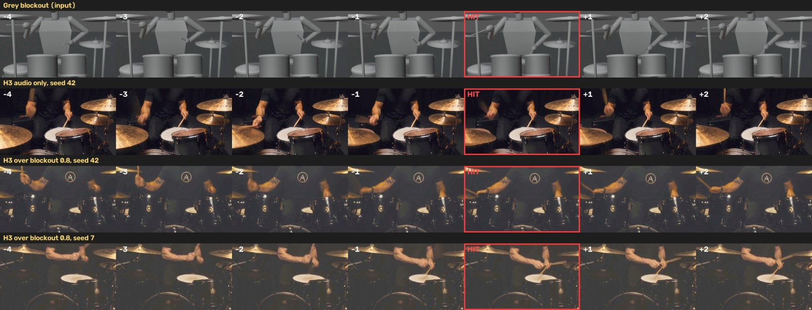
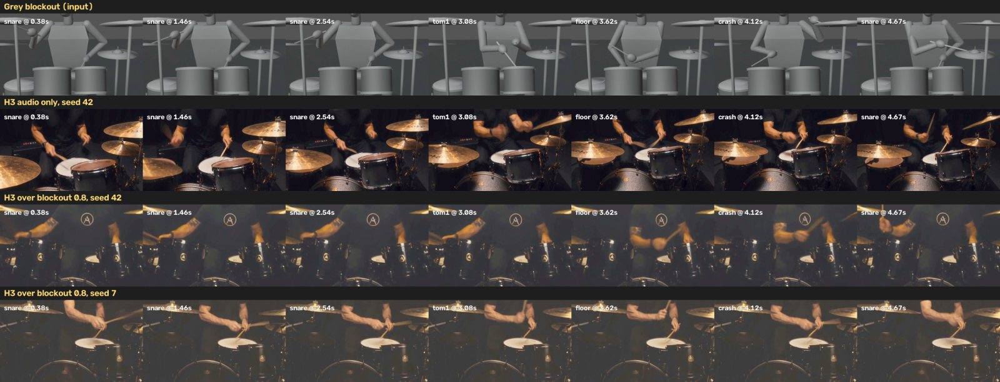
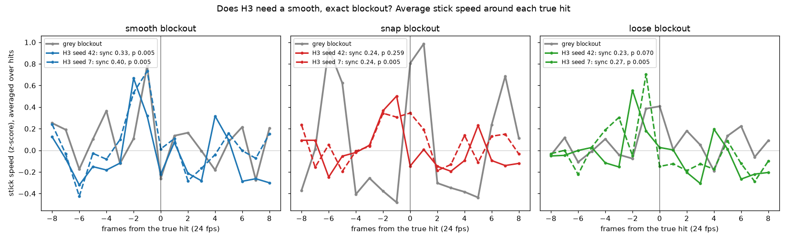
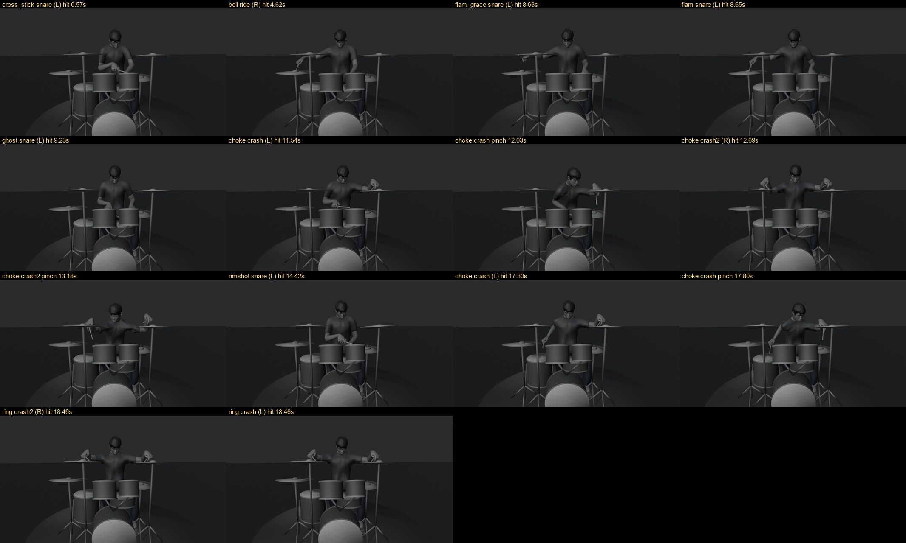
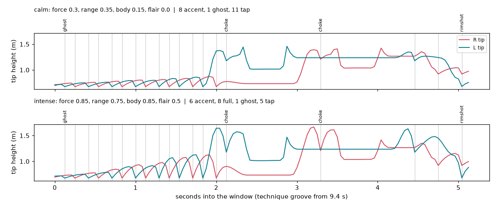
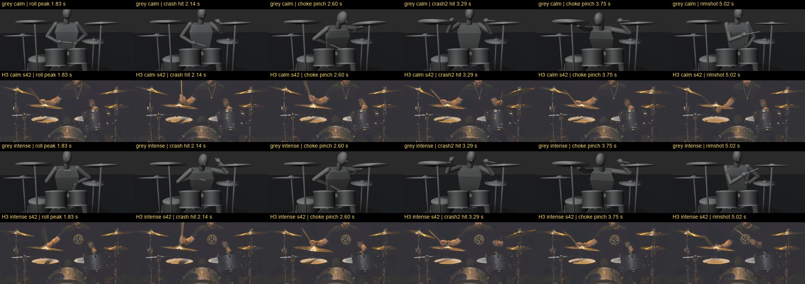
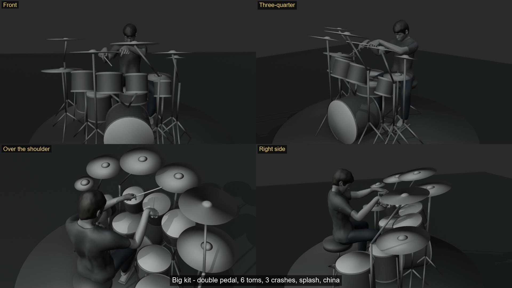
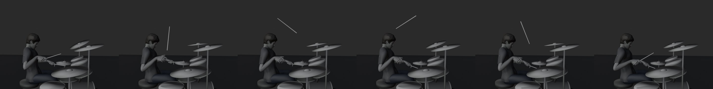

# h3_band_TFCV

Multi-performer music-video shots on **MiniMax H3**: the singer's mouth on the vocal *and* the guitarist's hands on the guitar, in the same shot.

## The problem

H3 generates video and audio jointly, with **one** audio stream and one attention pass over the whole frame. Nothing tells it which sound belongs to which part of the frame. Drive a two-person shot with the full mix and it guesses: everyone sings, or one person performs and the other freezes.

## The approach

1. **Pre-isolate.** Split the song into stems (dry lead vocal, guitar, drums, backing vocals) and define the **zones of action** in the frame (a box per performer).
2. **Isolated runs.** One H3 run per zone. Only that zone regenerates, driven by **its own stem** frozen into H3's audio stream. Everything outside the zone is locked to the previous take.
3. **Merge.** A low-denoise pass over the whole frame under the full mix, to settle the seams.

```
song.wav ──separate──▶ vocals_dry / guitar / drums / backing
                              │
shot spec (zones) ──preflight──▶ cut stems + jobs ──run_chain──▶ base → zone A → zone B → merge
                                                                    (each take scored per zone)
```

## How the lock works (per-token noise masks)

`comfy_nodes/h3_band_zone_latent.py` (**H3 Band Zone Latent**) writes per-stream noise masks onto the AV latent:

- **mask 0**: the token is fed in clean at the condition timestep and pinned to that content to the end. With `audio_denoise=0`, the stem is in H3's audio stream, clean, from the very first step.
- **mask 1**: generated from scratch.
- **fractional mask m**: the token runs at m·σ, which is partial re-noise.

An isolated run is `mode B` + `video_denoise 0` (the take is locked) + a zone box at `zone_denoise`.

**Zone sizing, what we've seen so far:**
- A lip sync works with a head box at about **0.92**, because a mouth moves a few pixels.
- Instrument motion did **not** appear at 0.92. Because of H3's sigma shift, 0.92 leaves the region about half-noised, so the pose survives and only the texture changes.
- At **1.0** with a box over only the lower body and the instrument body, the performer was regenerated but still didn't strum. The locked guitar neck and raised arm above the box pinned the pose.
- At **1.0** with a box over the **whole performer and the whole instrument**, plus a prompt that describes playing instead of posing, the guitarist **plays**: the picking arm moves with motion blur. The strokes are **not on the beat**.
- Adding drums under the guitar in the audio stream, or a "hard strum on every beat" prompt, didn't change that.
- **The prompt sets the amount of motion.** "Hard, on every beat" gives big swings; "small, tight strokes, fretting hand slides, gentle sway" gives a calmer performance. It doesn't set the timing.
- **Retiming an H3 take onto the onsets** (time-warping the zone with DTW so its stroke peaks land on the onsets) failed: the generated strokes weren't distinct enough to align.
- **Conclusion:** H3 doesn't place a strum or a key press on a specific onset from the audio alone. Its video tokens span 4 frames, finer than a 16th-note strum, and nothing ties a background performer's hand to the stem. Timing has to be in the pixels before H3 sees them, which is what `blockout/` does (below).

## Setup

**Not included:** ComfyUI, the MiniMax H3 weights, separator checkpoints, the face landmark model, and any input media.

1. **ComfyUI with MiniMax H3 support and per-token noise masks on nested AV latents** (upstream ComfyUI PR #15375). Without that PR the zone latent still loads, but the sampler applies its masks as inpaint blending, a looser lock. Copy `comfy_nodes/h3_band_zone_latent.py` into `ComfyUI/custom_nodes/`. H3 file names default to the values in `h3band/config.py` (`H3B_UNET`, `H3B_CLIP`, `H3B_VAE`, `H3B_AUDIO_VAE`).
2. **Two venvs.** They're kept separate because mediapipe and torch pins fight.
   ```bash
   python3 -m venv .venv_score && .venv_score/bin/pip install -r requirements-score.txt
   python3 -m venv .venv_sep   && .venv_sep/bin/pip install torch torchaudio --index-url https://download.pytorch.org/whl/cpu \
                               && .venv_sep/bin/pip install -r requirements-sep.txt
   ```
3. **Face model** for `sync_score.py`:
   ```bash
   mkdir -p models && curl -L -o models/face_landmarker.task \
     https://storage.googleapis.com/mediapipe-models/face_landmarker/face_landmarker/float16/1/face_landmarker.task
   ```
4. **Paths.** Everything is set by env vars (see `h3band/config.py`):

   | var | default | what |
   |---|---|---|
   | `H3B_WORK` | `./work` | working dir |
   | `H3B_SONG` | `work/song/mix.wav` | full mix |
   | `H3B_BEATS` | `work/song/beats.json` | `{"beats": [s, ...]}` |
   | `H3B_STEMS_DIR` | `work/stems` | `vocals_dry.wav guitar.wav drums.wav backing.wav bass.wav mix.wav` |
   | `H3B_GUITAR_EVENTS` | `work/guitar_events.json` | output of `guitar_events.py` |
   | `H3B_COMFY_URL` | `http://127.0.0.1:8188` | ComfyUI API |
   | `H3B_COMFY_INPUT` / `H3B_COMFY_OUTPUT` | `./ComfyUI/input` / `output` | ComfyUI dirs |
   | `H3B_MODEL_DIR` | `./models` | audio-separator checkpoints |
   | `H3B_FACE_MODEL` | `models/face_landmarker.task` | mediapipe model |

## Workflow

```bash
cd h3band
# 1. stems: separate from the mix, or drop generator stem exports (e.g. Suno) into $H3B_STEMS_DIR under the generic names
../.venv_sep/bin/python separate.py                        # vocal -> dry vocal, 6-stem split
../.venv_sep/bin/python stem_quality.py q.json dry=$H3B_STEMS_DIR/vocals_dry.wav gtr=$H3B_STEMS_DIR/guitar.wav --ref dry
# 2. pattern identifiers
../.venv_sep/bin/python guitar_events.py $H3B_STEMS_DIR/guitar.wav $H3B_BEATS $H3B_GUITAR_EVENTS --drums $H3B_STEMS_DIR/drums.wav
../.venv_sep/bin/python align_lyrics.py $H3B_STEMS_DIR/vocals_dry.wav lyrics.json align.json      # optional
../.venv_sep/bin/python vocal_activity.py $H3B_STEMS_DIR/vocals_dry.wav va.json --align align.json  # optional
# 3. pre-flight a shot (cuts stems, checks zones, writes jobs)
../.venv_score/bin/python shot_preflight.py ../examples/shot_example.json
# 4. run the chain (needs ComfyUI up)
../.venv_score/bin/python run_chain.py demo_duo --dry-run
../.venv_score/bin/python run_chain.py demo_duo
```

**Choosing a lead vocal.** Use the stem with real silence between phrases: high per-5-s dynamic range and a high silent fraction in `stem_quality.py`. A reverb-washed or doubled vocal never goes quiet, so the mouth never closes. A de-reverb pass on a separated vocal often beats a generator's own vocal stem, which can keep doubles and gang vocals.

**Starting from an existing take.** Put `"plate": "<input-relative mp4>"` in the spec. The base run is skipped and the first zone run locks to that take. Mind any preroll: `song_start` is where the *render's* frame 0 sits in the song.

## Scorers (each with its own control)

- **`sync_score.py VIDEO AUDIO --box x0,y0,x1,y1`**: mediapipe FaceLandmarker `jawOpen` (plus the inner-lip gap) against the vocal envelope (150–4000 Hz RMS dB). It reports:
  - peak cross-correlation and its lag over ±8 frames
  - correlation at lag 0
  - closed-mouth-in-silence and open-mouth-in-voice rates
  - the fraction of frames with no face found.

  Use `--shift S` for a time-shifted audio control. `jawOpen` is the signal that separates real audio from the control; the lip gap doesn't. Small or mic-occluded faces use a tiled search plus a tracked upscaled crop.
- **`strum_score.py VIDEO EVENTS SONG_START --box ...`** (v1): Farneback optical-flow magnitude in the box (detrended) against the guitar onset train, with the onsets shifted by 1, 2 and 3 s as controls. Body bounce and camera moves swamp it; use v2.
- **`strum_score2.py VIDEO EVENTS SONG_START --box ... [--beats BEATS] [--grid-lag S]`** (v2): the picking-stroke signal. It uses MediaPipe hand landmarks when a hand is found in at least half the frames. Otherwise it takes optical flow with the zone's median motion removed (bounce, push-in) and picks the 3x3-cell sub-box with the most motion above 3 Hz. It scores stroke speed against the onset train, with controls (onsets shifted 1/2/3 s, another song section) and a permutation p-value over 200 circular shifts. `sync_margin` = real minus the best control.
  - Validation: a synthetic onset-locked jolt under a ±25 px random-walk body bounce scores +0.59 (p 0.005), where v1 reads 0.00. A static plate scores −0.09.
  - **Pass a tight `--box` around the picking hand and check the reported `subbox`.** Given a whole-performer zone, the sub-box search once locked onto drifting stage smoke beside the guitarist and reported a false "in sync" (+0.10, p 0.005).
  - At 24 fps a 16th note is about 3 frames, so beat-phase locking (metric `b`) can't separate synced from static; it's reported but not used.
- **`drum_sync_score.py VIDEO HITS.json START [--box ...]`**: stick speed (`strum_score2`'s sub-box flow signal) against the hand hits (kick and hi-hat pedal dropped) within ±2 frames. Controls: the hits shifted by half their median gap (between the hits) and by 1/2/3 s, plus a 200-shift permutation p-value. strum_score2's ±4-frame search let shifted controls slide back onto an 8th-note groove.

## Known limits

- **Video tokens are about 4 frames long.** H3's latent frames cover 1, 4, 4, 4, 4 pixel frames per 17-frame clip, and a token is 32 px. 16th-note strums are finer than one video token, so strum timing has to come through the 40 Hz audio tokens.
- **The lyric aligner is weak on sung vocals.** torchaudio MMS_FA is speech-trained: expect about ±0.5 s on half the words, and character spans rather than phonemes. Vocal activity leans on dry-vocal energy.
- **Stroke direction** (down vs up, from low-vs-high band rise timing) is a weak signal; treat individual calls as unreliable.
- **One shared audio stream per run.** The zone runs work around this by freezing one stem per run; they don't solve it.

## Instrument blockouts (`blockout/`)

Zone runs gave lip sync, but not instruments: H3 doesn't learn a strum or a key press from the audio alone. H3 *is* good at painting over grey 3D blockouts. So we animate primitive performers playing the actual notes, render grey footage, and let H3 re-skin it with the stem locked in its audio stream. The timing is in the pixels.

| file | what |
|---|---|
| `midi.py` | MIDI reader (notes in seconds, beat/downbeat grid from the time signature). No dependencies. |
| `feeling.py` | Feeling chart → performance: per-bar strength, touch (caress..strike), freedom, tempo (rubato) and head style, plus phrase breathing, voicing and seeded per-note variation. |
| `piano.py` | Fingering (Viterbi, Parncutt-style costs), hand glide, per-touch strike/press/release, arm weight, phrase "breaths", finger IK, key travel. Collision: the keyboard is a heightfield (white keys, raised black keys, pressed keys lowered, rail, fallboard); finger pads sit on it by their radius, every finger segment is lifted out of it, and pressing fingers pull the hand within reach. Each run reports `qa`: finger-frames inside a key, strikes in the hit pad, crossed fingers, and `reach` (pressing fingertips that don't get to their key). Plain numpy. |
| `dynamics.py` | Second-order springs (frequency, damping, response) that every motion target runs through: anticipation, overshoot, follow-through. |
| `suite.py` | Splices an original theme and excerpts into one MIDI on bar boundaries, with a per-bar tempo map (the Knight's Suite). |
| `cameras.py` | Music-driven camera edit: cuts on downbeats (on beats at the climax), shot length and shot choice follow the energy (wide, first-person, orbit, hand tracking, close-ups, overhead, low hero angle, grazing keyboard, closing pull-back), operator-smoothed tracking. Render with `--view edit`. |
| `performer.py` | Shared body: torso, neck, head, 2-bone arm IK, and head styles driven by the beat grid (`focused`, `groove`, `wild`, `crowd`, `expressive`). |
| `blender_piano.py` | Blender renderer: grey 88-key piano, capsule performer, `pov` (camera rides the eyes), `three4`, `side`, `edit` views. `--hands mpfb` (default): a real rigged, skinned CC0 hand from MPFB2 on the primitive wrists, each bone posed from the joints (wrist, metacarpals, MCP/PIP/DIP; thumb CMC/MCP/IP). `--hands capsule`: the mannequin. `--hands skin`: a Skin-modifier tube stopgap. |
| `hand_model/` | `mpfb_make_hand.py` makes the hand (Blender 4.2+ with the MPFB2 extension, run on an x86-64 box). `mpfb_hands.blend` is the skinned hands and rig. `mpfb_hands.json` has the rest bones and measured finger radii. `piano.py --hand mpfb` (default) takes its segment lengths, knuckle layout, palm length and radii from this file, and solves the thumb with joint limits (CMC cone, MCP/IP hinges). `mpfb_make_body.py` makes the drummer's whole body: the same man (same macros, so the same hands, to the bone), with MPFB2 targets that bring his torso, neck, shoulders, ribcage, upper arms, legs and feet toward the drum solver's performer. Given the unzipped CC0 MakeHuman system asset pack, he is dressed in T-shirt, jeans and sneakers, with short hair and eyebrows; the skin under the clothes is cut away and the asset materials are dropped, so `mpfb_body.blend` needs nothing else. MPFB2 code is GPL-3.0; the generated meshes and the MakeHuman system assets are CC0. |
| `sampler.py` | Sampled grand piano (SFZ+FLAC) with automatic pedal and room reverb. |
| `synth.py` | Dependency-free additive piano, for quick timing checks. |
| `drums.py` | Sticking (beam search over hand preference, travel and crossing), velocity-scaled strokes landing on the onset frame, sprung wrists, kick and hi-hat pedals with leg IK, double pedal. With physics on (the default): hitboxes, cymbals as damped oscillators, per-surface rebound and head give. Plain numpy. Reads a GM drum MIDI or a hit list from `h3band/drum_events.py`. |
| `drum_kit.py` | Kits as data: presets (`standard`, `double_pedal`, `big`) or a typed spec of pieces by type and size, laid out by rule around the seat and nudged until nothing clashes and every piece is in reach. |
| `drum_hands.py` | The piano's rigged MPFB2 hand (`blockout/rig`) holding a stick. The grip is solved once per side: the stick runs under the palm from the heel to the index finger, fingers 2-5 close on it until each bone touches, and the thumb presses at the fulcrum. Gives the wrist the arm reaches for, the fist hitbox, wrist bend and strain costs for the arm planner, and an open hand for the stick toss. |
| `drum_collide.py` | Signed-distance hitboxes for the kit, stands and drummer. Moves sticks, fists and elbows out of anything they are not playing, including the other hand's stick and arm, and reports any clip left (`python -m blockout.drum_collide ANIM.json`). |
| `drum_body_clip.py` | Clip check on the drawn drummer instead of the hitboxes: in Blender, poses the dressed MPFB2 body as `blender_drums.py` draws it and measures how deep any skin, clothing or shoe vertex goes into the kit, either stick, or the drummer's own head, torso, thighs and other arm. |
| `drum_toss.py` | Stick toss and catch: the hand flicks the stick up, it flies on a ballistic arc turning end over end, and lands back in the hand. |
| `blender_drums.py` | Blender renderer: grey kit and the dressed MPFB2 drummer (`hand_model/mpfb_body.blend`), posed bone by bone onto the solved joints. Each bone's head sits on its joint and stretches to the solved segment. Each limb rolls to its own bend plane, the spine and neck share the torso and head turns, the forearm takes part of the hand's roll, and the feet follow the solved heel, ball and toe. The hands are posed from `drum_hands.py`. `DRUM_BODY=prims` (or a JSON without hand angles) gives the older capsule drummer. Views: `front`, `three4`, `side`, `over`, `top`, or `--cam` for any eye and look-at point. |
| `drum_style.py` | Drummer emotion: `force`, `range`, `body`, `flair` sliders, the `calm` / `groove` / `intense` / `showy` presets built from them, and a timeline that crossfades between presets. Sets stroke heights, arm lift, torso lean and cymbal follow-through. |
| `drum_mocap.py` | A real drummer's head and trunk motion as a style for `drums.py --mocap`: SAM 3D Body mocap of a drum-cam clip, kept from the shots whose strokes lock to the clip's audio beats, stored in beat time and laid on the song's beats in seeded random 4–8 beat chunks. `drum_mocap_chad.json` is built from Chad Smith's "Otherside" clip, `drum_mocap_carey.json` from Danny Carey's "Pneuma" drum cam and `drum_mocap_baker.json` from a Ginger Baker solo. |
| `drum_blend.py` | Style blending between drummers: a classifier gives each note the odds of `groove`, `fill`, `accent` and `soft`, a blend matrix gives each label its mix of drummers, and the mix follows the notes by those odds (`drums.py --mocap chad,carey --blend "groove=chad,fill=carey"`), or a timeline in seconds. The classifier is Jev through `drum_jev.py`, or a rule classifier offline. `drums.py --drummer carey` plays as one drummer, with that drummer's mocap and kit. |
| `drum_jev.py` | Jev, TypeSafe's decision model, as the note classifier: one request per bar, written out as text with the bars around it, and one question per beat. Answers are cached by request, so a song asked once re-runs offline. Needs `TYPESAFE_API_KEY` for anything not in the cache. |
| `drum_teacher.py` | Technique teacher: reads the hits in their musical context and picks chokes, rimshots, cross-sticks, ride bell, flams and ghost notes, with the reason for each. `drums.py` plays them. |
| `drum_groove.py` | Writes the original example grooves (`examples/drums/rock_groove.mid`, `technique_groove.mid` with `--song technique`, a 30 s big-kit piece with `--song showcase`, a gap for a stick toss with `--song toss`), and with `--song random` a groove made up from the seed and tempo. `--song tool` and `--song baker` make up whole songs in Danny Carey's and Ginger Baker's idioms, in odd and changing meters. |
| `drum_random.py` | Random beats against overfitting: plays the drummer on random grooves at random tempos, kits and emotions, with and without the mocap, and runs the same checks as the fixed grooves on every take. `--song tool` / `--song baker` does the same on those songs, with that drummer's mocap. |
| `drumsynth.py` | Numpy drum synth: a hit list to a WAV, for timing checks and as ground truth for `drum_events.py`. Sounds the techniques too (a choked crash stops dead). |

```bash
python3 -m venv .venv_blockout && .venv_blockout/bin/pip install -r requirements-blockout.txt
mkdir -p work                                            # the commands below write here
# piano samples (Salamander Grand Piano V3, CC-BY 3.0, Alexander Holm), into models/:
#   https://freepats.zenvoid.org/Piano/acoustic-grand-piano.html  (SFZ+FLAC)
P=.venv_blockout/bin/python
$P -m blockout.piano examples/piano/clair_de_lune.mid work/cdl.json \
   --feeling examples/piano/clair_de_lune.feeling.json --notes-out work/cdl_notes.json
blender -b --factory-startup -P blockout/blender_piano.py -- work/cdl.json work/frames --view three4
$P -m blockout.sampler work/cdl_notes.json work/cdl.wav --sfz models/.../SalamanderGrandPiano-V3+20200602.sfz
```

**Drums.** From a GM drum MIDI, or from a drum stem through `h3band/drum_events.py`:

```bash
$P -m blockout.drums examples/drums/rock_groove.mid work/drums.json --hits-out work/drum_hits.json \
   --schedule 0:focused,8:groove,24:wild
$P -m blockout.drumsynth work/drum_hits.json work/drums.wav            # timing reference audio
blender -b --factory-startup -P blockout/blender_drums.py -- work/drums.json work/drum_frames --view front
# or from a real stem (beats JSON optional; it drives the head styles):
(cd h3band && ../$P drum_events.py $H3B_STEMS_DIR/drums.wav ../work/drum_events.json)
$P -m blockout.drums work/drum_events.json work/drums.json --beats $H3B_BEATS
```

`drums.py` prints a check after every run: stick-tip contact error on the onset frames (about 0.1 mm max on the example), frames where a tip goes through a head (0), kicks with the beater on the head on their onset frame (all), and the furthest reach against the arm length. `--clips` adds the hitbox report (frames where a stick, fist or arm goes into something it isn't playing). `--kit` plays on another kit and `--toss` adds stick tosses; see [Drum kits, physics and stick tosses](#drum-kits-physics-and-stick-tosses).

`drum_body_score.py ANIM.json [--curves OUT.png] [--groove]` checks the drummer's head, trunk and arms against a real drummer. The reference, `drum_body_ref.json`, comes from SAM 3D Body mocap of four shots (18 s) of Chad Smith's "Otherside" drum cam (`drum_body_sources.json`); `--ref blockout/drum_body_ref_carey.json` or `drum_body_ref_baker.json` scores against Danny Carey or Ginger Baker instead (see [Three drummers](#three-drummers-and-blends-of-them)). `h3band/sam3d_mocap.py VIDEO OUT` makes the BVH on a ComfyUI that has the SAM 3D Body nodes. Posture is measured per frame in the trunk frame, and motion as the p5–p95 range in each 2 s window. Each measure is gated the way the piano's `human_score.py` gates: OUT if our median falls outside the reference IQR, or our p5/p95 falls outside the reference p5–p95. Limits: each reference is one drummer, and the hips are hidden behind the kit, so the trunk-on-pelvis measures are reported but not gated. The wrist rows (where each hand works, in arm lengths) depend on the kit, so they aren't gated either.

`--groove` keeps only the frames where the right hand is on the hi-hat and the left on the snare, ours and Chad's, so fills and crashes don't decide the arm verdict. Measured that way on the rock groove with `--mocap`, the old standard kit had the hi-hat hand working at shoulder height and the left arm folded back beside the snare. The standard kit is now laid out off these numbers (see Physics), and the drummer sits upright over the hips, as Chad does:

| groove frames, median | old kit | new kit | now, with elbow rise | Chad (IQR) |
|---|---|---|---|---|
| right elbow bend | 92° | 105° | 105° | 104° (92–111) |
| right upper arm raised | 59° | 31° | 33° | 26° (22–34) |
| right upper arm forward | 57° | 27° | 28° | 20° (13–26) |
| left elbow bend | 120° | 100° | 100° | 82° (73–96) |
| left upper arm out to the side | 19° | 30° | 27° | 15° (10–23) |
| left upper arm forward | −30° | 7° | 7° | 23° (13–32) |
| trunk lean forward | 6.9° | 2.0° | 2.5° | −0.5° (−6.2–5.0) |
| right / left elbow lift per stroke | 15° / 9° | 11° / 4° | 15° / 11° | 24° / 10° |
| gated measures OUT | 11 of 20 | 9 of 20 | 8 of 20 | |

On the new kit the right arm is in Chad's range except its forward angle, 1° past the IQR. The left arm reaches forward instead of folding back, but its elbow stays more bent than Chad's and it wings out to the side. Moving the hi-hat trades these against each other (2 cm nearer brings the left upper arm in to Chad's side angle but drops it below that range, and bends the right elbow past it), so what's left is the elbow solver, not the layout. Both elbows also lifted less per stroke than Chad's, less than on the old kit. The elbow rise (see [Arms from the mocap](#three-drummers-and-blends-of-them)) brings both lifts inside Chad's range.

`--mocap blockout/drum_mocap_chad.json` drives the drummer's head and trunk with a real drummer's motion, on the song's beats. `drum_mocap.py --build blockout/drum_body_sources.json OUT.json` makes the style from the same BVH as the body score. It tracks the beats in the clip's audio (librosa) and keeps a shot only if its wrist strokes lock to the 8th-note grid (Rayleigh test, p ≤ 0.05, with each shot's own offset for the multi-camera edit). On the Chad clip that leaves shots s3 and s4, 16 beats: s1's audio isn't the drumming, and s2 doesn't lock (p = 0.08). The head-on-trunk and trunk angles are low-passed at 6 Hz and stored every 1/24 beat. A take gets seeded random chunks of 4, 6 or 8 beats starting on even beats and crossfaded over one beat, so the motion follows the song's tempo and `--seed` changes it. The clip's bar phase is unknown, so even clip beats go on the song's downbeat parity. s3 and s4 are Chad's busiest shots, so each channel gets a gain that brings its motion to the whole reference's, less what our drummer moves on his own (see [Three drummers](#three-drummers-and-blends-of-them)): nod 0.55, head turn 0.54, tilt 0.48, trunk sway 0.63, shoulder turn 1.09. Under an emotion the body slider scales it (calm 0.67, groove 1, intense 1.44), and `--mocap-gain` on top. The mocap replaces the head style's beat nod and sway. The resting gaze, the look toward the hands, the leans and the turns to cymbals stay. The wrists and sticks are planned without it, and where its sway would take a shoulder out of reach of a stroke (a far tom or crash on a beat where the clip leans back), it gives way for that moment by the least share that keeps the reach. So the hits and the checks don't change (0.1 mm contact, no tip through a head, 47 of 47 kicks), and without `--mocap` the output is byte-identical. On the rock groove the medians go from nod 7°, head turn 4°, tilt 6°, trunk sway 1.9° and shoulder turn 1.5° without it to 28°, 22°, 9°, 3.1° and 8.9° with it. Chad's are 23°, 27°, 11°, 5.6° and 10.7°. Calm moves less than Chad and intense more, by design. Limits: 16 beats of Chad, so a long take repeats them (Carey and Baker have more, below), and the arms take only targets from the mocap. Over all frames the arm rows stay OUT with or without it, because fills and crashes put the hands where Chad's groove never does. `--groove` compares like with like (above).

`drum_events.py` is a band-energy heuristic, not a transcriber. Pass `--truth HITS.json` to score it against a known hit list: render a MIDI through `drums.py --hits-out` and `drumsynth.py`, then detect on the WAV. On the synthesized example grooves it finds kick, snare, hi-hat and crash at about 0.7–0.9 recall and 0.9–1.0 precision. Ride hits come out at about 0.6 and toms are unreliable. The numbers for each piece are in the module docstring. A real mixed stem will score lower, so check the hit list before rendering a long take.

Example MIDIs from the Mutopia Project: Clair de Lune, Rondo alla Turca and Brahms Op. 118 No. 2 are Public Domain; Rachmaninoff Op. 3 No. 2 is CC BY-SA 4.0. `knights_suite.mid` (built by `suite.py`) contains an original theme plus excerpts of the Rachmaninoff (CC BY-SA 4.0) and the Brahms.

## Drum blockout in ComfyUI, driven by the Comfy SDK

`comfy_nodes/h3_band_drums.py` puts the drum blockout in a ComfyUI graph:

| node | in | out |
|---|---|---|
| **H3 Band Drum Events** | `AUDIO` (a drum stem) | `DRUM_HITS` from `h3band/drum_events.py` |
| **H3 Band Drum Hits (MIDI)** | a GM drum `.mid` in the input dir | `DRUM_HITS` with the MIDI's beat grid |
| **H3 Band Drum Teacher** | `DRUM_HITS`, `choke_gap` (beats of silence that make a loud crash a choke) | `DRUM_HITS` with techniques, and the lesson sheet as a `STRING` |
| **H3 Band Drum Kit** | a preset, or a kit spec typed as JSON (prose and code fences around it are fine) | `DRUM_KIT` from `blockout/drum_kit.py`, and a report `STRING` (what the parser changed, each piece, the clash and reach check) |
| **H3 Band Drum Synth** | `DRUM_HITS`, seed, optional `DRUM_KIT` | `AUDIO`: `blockout/drumsynth.py`, techniques included, tuned and panned by the kit |
| **H3 Band Drum Blockout** | `DRUM_HITS`, `start` (s), `frames`, `fps`, size, view or `camera`, head schedule, `motion` (smooth / snap / loose), `emotion` timeline, `force` / `range` / `body` / `flair` overrides, optional `DRUM_KIT`, `tosses`, `drummer` (with their kit unless one is wired in), `mocap` and `blend` (as `drums.py`), `classifier` (`auto` / `jev` / `rules`) | `IMAGE`: grey kit frames from `blockout/drums.py`, rendered by Blender; a report `STRING` (contact check, tiers, tosses, lesson) |

The frames begin at `start` seconds into the hits, so `TrimAudioDuration` (start = `start`, duration = frames / fps) gives the matching audio for `CreateVideo`. The same frames can be VAE-encoded as the take for an H3 zone run. A blend that asks Jev needs `TYPESAFE_API_KEY` in the ComfyUI server's environment, unless the song is in `blockout/drum_jev_cache.json`; `auto` falls back to the rules without it. `examples/workflows/drum_blockout_api.json` is the stem → hits → blockout → MP4 graph in API format.

`h3band/sdk_drum_blockout.py` runs that graph through the official [Comfy SDK](https://docs.comfy.org/development/api-development/sdks) (`comfy-sdk`, MIT). It uploads the stem or MIDI as an asset, sets the inputs, follows the job's progress events and downloads the video:

```bash
# ComfyUI side: the nodes import blockout/ and h3band/ from this repo, so link the folder rather than copy the file
#   (a copied folder works too with H3B_REPO=<repo>). It also loads H3 Band Zone Latent when the ComfyUI supports it.
ln -s "$PWD/comfy_nodes" ComfyUI/custom_nodes/h3band     # Windows: mklink /J ComfyUI\custom_nodes\h3band comfy_nodes
ComfyUI/.venv/bin/pip install soundfile                 # numpy, scipy and Pillow ship with ComfyUI
export H3B_BLENDER=/path/to/blender                     # default: blender on PATH
python ComfyUI/main.py --port 8188 &

# client side: the SDK talks Comfy API v2, which a self-hosted ComfyUI serves through comfy-api-proxy
python3 -m venv .venv_sdk && .venv_sdk/bin/pip install -r requirements-sdk.txt
.venv_sdk/bin/comfy-api-proxy run --comfyui http://127.0.0.1:8188 --port 8189 &
cd h3band
../.venv_sdk/bin/python sdk_drum_blockout.py $H3B_STEMS_DIR/drums.wav ../work/drums_blockout.mp4 --start 8 --frames 121
../.venv_sdk/bin/python sdk_drum_blockout.py ../examples/drums/rock_groove.mid ../work/groove.mp4 \
    --audio ../work/drums.wav --view three4 --heads 0:wild      # MIDI hits, a drumsynth render as the soundtrack
```

`COMFY_BASE_URL` picks the server (default `http://127.0.0.1:8189`). On an RTX 5060 Ti, 121 frames at 1280x704 (Workbench) take about 17 s on the server, including detection. The node loads every frame into one `IMAGE` batch (about 10 MB per 1280x704 frame), so render long takes in sections.

### H3 over the drum blockout

`h3band/sdk_drum_h3.py` builds the whole H3 graph and runs it through the same SDK path. The drum stem is trimmed to the window and frozen in H3's audio stream by H3 Band Zone Latent (`audio_denoise` 0). With `--blockout`, the grey frames from H3 Band Drum Blockout are VAE-encoded as the starting video latent and sampled over the last `--steps` of `round(steps / denoise)` steps. `--no-blockout` starts the video from noise: what H3 does from the audio alone. The stack is the lab's turbo graph: w4a8 fl2va DiT, Turbo v4 LoRA + Turbo Sampler (8 steps), realism LoRA, sigma shift 12/3, 1280x736, 124 frames.

```bash
cd h3band
../.venv_sdk/bin/python sdk_drum_h3.py ../work/C.mp4 --midi ../examples/drums/rock_groove.mid --audio ../work/drums.wav \
    --blockout --denoise 0.8 --start 13
../.venv_sdk/bin/python sdk_drum_h3.py ../work/B.mp4 --midi ../examples/drums/rock_groove.mid --audio ../work/drums.wav \
    --no-blockout --start 13
python drum_sync_score.py ../work/C.mp4 ../work/drum_hits.json 13      # in an env with opencv + mediapipe
```

Results on the example groove, 13.0–18.2 s (the fill into the next section), same prompt and audio for every take, seed 42 unless noted, about 6.5 min each on an RTX 5060 Ti:

| take | stick sync | best control | margin | p | look |
|---|---|---|---|---|---|
| A: grey blockout | 0.331 | 0.185 | +0.146 | 0.005 | grey capsule drummer |
| B: H3, audio only | 0.076 | 0.149 | −0.073 | 0.80 | real drummer, H3 picks its own close-up framing |
| C: over blockout, denoise 0.6 (8 of 13 steps) | 0.308 | 0.156 | +0.152 | 0.05 | real drummer, the kit stays matte grey |
| C: over blockout, denoise 0.8 (8 of 10) | 0.325 | 0.194 | +0.131 | 0.005 | real drummer and kit, the blockout's framing |
| C: over blockout, denoise 0.89 (8 of 9) | 0.124 | 0.167 | −0.043 | 0.24 | real drummer, framing drifts, timing gone |
| B, seed 7 | 0.034 | 0.172 | −0.139 | 0.73 | real drummer |
| C at 0.8, seed 7 | 0.401 | 0.135 | +0.266 | 0.005 | real drummer and kit, the blockout's framing |

These are over the first blockout, the capsule drummer. H3 over the dressed drummer and the re-laid kit is under [H3 over the dressed drummer](#h3-over-the-dressed-drummer).

From the audio alone H3 paints a convincing drummer whose sticks don't follow the hits. Over the blockout at 0.6–0.8 the sticks keep the blockout's timing, about as well as the blockout itself, and 0.8 is the first strength where the kit no longer looks grey. At 0.89 the blockout is too faint to hold either the timing or the camera. ComfyUI's `BasicScheduler` floors `steps / denoise`, so 8 steps at denoise 0.9 there is the full schedule from noise. That take came out as the same video as B, which is why the script splits the sigmas itself.

One snare backbeat (1.46 s into the window), frame by frame from 4 frames before the hit to 2 after, cropped to the hands and brightened. Over the blockout, seed 7's right stick is up at −4 and on the snare at the hit. Seed 42's arm comes down on the hit but is motion-blurred. With audio only, the stick is mid-stroke at the hit:



The frame at each big hit in the window. The blockout moves to the toms (3.08 s, 3.62 s) and reaches for the crash (4.12 s):



**Limitation: the timing of the strokes transfers, but not which drum they land on.** Through the fill, the seed 7 drummer keeps playing the snare in time while the blockout moves around the toms, and seed 42 is a blur. `drum_sync_score.py` measures stroke timing only, so it doesn't see this. Getting limb placement to carry over probably needs a lower denoise in the fill or a stronger blockout (thicker sticks, contrasting drum heads); neither has been tried.

`drum_sync_score.py` only separates synced from unsynced on varied playing. On the steady 8th-note groove (8.0–13.2 s) the blockout itself fails its between-hits control (margin −0.02), so score fills and breaks. All of these takes use the `drumsynth.py` render of the MIDI; H3 over a blockout driven by a real drum stem hasn't been scored yet.

#### How exact does the blockout have to be?

`--motion` (and the node's `motion` input) swaps the blockout's stroke motion, everything else held fixed:

- `smooth`: the rules in `blockout/drums.py`. Eased strokes, springs on the hands, tips on the head on the hit frame.
- `snap`: two poses with no easing and no springs. The tip is on the head on the hit frame and at the next stroke's prep height on every other frame.
- `loose`: smooth, but every hand hit lands up to 2 frames (83 ms) early or late and up to 8 cm off its strike point.

```bash
../.venv_sdk/bin/python sdk_drum_h3.py ../work/snap.mp4 --midi ../examples/drums/rock_groove.mid --audio ../work/drums.wav \
    --blockout --denoise 0.8 --start 13 --motion snap
```

Same window, prompt and audio as above, denoise 0.8, scored against the true hit times:

| blockout | grey blockout: sync / margin / p | H3, seed 42 | H3, seed 7 |
|---|---|---|---|
| smooth | 0.331 / +0.146 / 0.005 | 0.325 / +0.131 / 0.005 | 0.401 / +0.266 / 0.005 |
| snap | 0.575 / +0.051 / 0.005 | 0.239 / −0.046 / 0.26 | 0.243 / +0.017 / 0.005 |
| loose | 0.255 / −0.018 / 0.005 | 0.234 / +0.100 / 0.07 | 0.267 / +0.156 / 0.005 |



- **The timing doesn't have to be exact.** With hits up to 2 frames off and aimed up to 8 cm wide, H3 still puts its strokes on the true hits (margins +0.10 and +0.16), at some cost in sync (0.23–0.27 against 0.33–0.40 for smooth). That margin is better than the loose blockout's own, so H3 seems to pull the strokes back toward the locked audio. This is two seeds, so treat it as a lead rather than a result.
- **The motion has to be smooth.** The snap blockout scores highest of the three as grey footage, but H3 drops most of it (margins −0.05 and +0.02). Its hit pose lasts one frame and H3's video tokens span 4, which is a likely reason the jump doesn't survive the encode.

So a blockout needs strokes that move continuously over several frames and land roughly on the beat. Exact timing and exact placement buy little.

### Drum performance: emotion, force and technique

The same hits can be played gently or hard, and some need a specific technique rather than a plain stroke. Two modules control this. Both are opt-in (`--emotion` and `--teach`); without them the blockout plays plain strokes.

**Emotion and force** (`blockout/drum_style.py`). Four sliders, 0 to 1:

| slider | what it changes |
|---|---|
| `force` | stroke height, and how much of the arm drives it |
| `range` | dynamic range: how far apart a ghost note and an accent look (0 plays every stroke alike) |
| `body` | how far the torso leans into big strokes, on top of the head style |
| `flair` | how high the stick follows through after a crash |

Presets combine them with a head style from `performer.py`: `calm` (0.30 / 0.35 / 0.15 / 0.00, head `focused`), `groove` (the neutral player), `intense` (0.85 / 0.75 / 0.85 / 0.50, head `wild`) and `showy` (0.75 / 0.90 / 0.70 / 1.00, head `crowd`). A timeline such as `0:calm,8:intense,16:showy` crossfades between them over 0.6 s, and any slider can be overridden for all presets. Every stroke gets a tier from its height: `ghost` and `tap` are wrist strokes, `accent` brings in the forearm and `full` lifts the whole arm. The arm lift and torso lean scale with the tier.

**Technique teacher** (`blockout/drum_teacher.py`). It reads each hit in context and writes down the technique and the reason:

| technique | when | what the blockout does |
|---|---|---|
| choke | a loud crash followed by at least a beat with no hand or kick hits | a free hand reaches the cymbal edge half a beat later and pinches it; the cymbal stops swinging (and the synth cuts the sound) |
| ring | a loud crash that is the last hit of the song | nothing extra: the cymbal is left to ring |
| rimshot | a snare at velocity 112 or more on beat 2 or 4 | the stick comes in flatter, so the tip lands on the head and the shaft on the hoop |
| cross-stick | GM side stick (note 37) | the stick lies across the snare and its far end clicks the rim, turned to where the rim is free (between the rack toms) and the arm is least awkward |
| bell | GM ride bell (note 53) | the tip lands on the ride's bell; the stick's angle and heading are searched like a home grip, so on a high ride the arm reaches out and the stick comes in close to level |
| flam | a soft hit 12–50 ms before a louder one on the same drum | the grace note is a low stroke from the other hand |
| ghost | a snare under velocity 50 | a wrist stroke a few centimetres off the head |

These are fixed rules rather than a learned model, so every choice can be explained. The lesson sheet is printed by `drums.py --teach` and returned by the Teacher and Blockout nodes. This is the window used below:

```
   time  bar  beat  piece   hand technique    why
   9.52    5  1.50  snare   L    ghost        soft snare: wrist only, tip a few cm off the head
  11.54    6  1.00  crash   L    choke        the band stops for 2.0 beats: pinch the edge 0.5 beats after the hit to cut it off
  12.69    6  2.99  crash2  R    choke        the band stops for 2.0 beats: pinch the edge 0.5 beats after the hit to cut it off
  14.42    7  2.00  snare   L    rimshot      loud backbeat on 2: tip and shaft hit head and hoop together
```

`examples/drums/technique_groove.mid` is a 9-bar study with one technique per bar (side-stick backbeats, ride bell, a flam, ghost notes, two choked crashes into stops, rimshot backbeats, another choke and a ringing last crash). The teacher finds all of them: 4 cross-sticks, 8 bells, 1 flam, 3 ghosts, 3 chokes, 2 rimshots and 2 ringing crashes. With every preset, the blockout check reports no tip going through a head and a furthest reach of 0.601 m against a 0.603 m arm.

```bash
$P -m blockout.drums examples/drums/technique_groove.mid work/tech.json --teach --emotion 0:calm,9:intense \
   --hits-out work/tech_hits.json                    # --force / --range / --body / --flair override the presets
$P -m blockout.drumsynth work/tech_hits.json work/tech.wav
cd h3band   # the same through the SDK; without --audio, H3 Band Drum Synth renders the MIDI in the graph
../.venv_sdk/bin/python sdk_drum_h3.py ../work/tech_intense.mp4 --midi ../examples/drums/technique_groove.mid \
    --teach --emotion 0:intense --blockout --denoise 0.8 --start 9.4
```

The grey blockout at each technique (full groove, `groove` preset, front view, where the rack toms hide most of the snare):



Stick-tip height over the H3 window for `calm` and `intense`. Calm keeps the crescendo roll in taps and accents. Intense builds it to full-arm strokes and follows through higher after each crash:



#### H3 over the technique blockout

One round: the window above (9.4–14.6 s, 124 frames), `--teach`, presets `calm` and `intense`, denoise 0.8, seeds 42 and 7, the same prompt and synth audio for every take, about 9 min each on an RTX 5060 Ti. Stroke size is the mean and 90th-percentile optical-flow speed in the stick area (camera motion removed, px per frame at 360 px):

| take | calm: mean / p90 | intense: mean / p90 | intense / calm (mean) |
|---|---|---|---|
| grey blockout | 0.724 / 1.823 | 1.341 / 2.574 | 1.85x |
| H3, seed 42 | 0.674 / 1.026 | 0.971 / 1.582 | 1.44x |
| H3, seed 7 | 0.326 / 0.591 | 0.295 / 0.490 | 0.90x |

The grey blockout, then the seed 42 take, at the roll peak, both crash hits, both choke pinches and the rimshot (`calm` on top, `intense` below):



- **Force carries over on one seed out of two.** Seed 42 keeps the blockout's framing, and its intense take plays bigger strokes than its calm one (1.44x, against 1.85x in the grey). The stick goes well above the cymbals on both crash hits. Seed 7 reframes to a side view at the kit level, mostly drops the blockout's arms, and plays both presets at the same size.
- **The choke doesn't carry over.** On the pinch frames the H3 hand is a motion blur near the cymbal, not a hand holding its edge. A pinch is a small, still pose next to big strokes, and H3 smooths it away. It probably needs a lower denoise around the choke, or a blockout hand that stays on the cymbal longer.
- **Rimshot, ghost and cross-stick differ from a plain stroke by a stick angle or a few centimetres.** At this resolution they can't be told apart in the H3 frames, so these results don't show whether they transfer.
- **No timing claim for this window.** It starts with a dense 16th-note roll, and `drum_sync_score.py` scores the grey blockout itself below its control here (margin −0.36 calm, −0.39 intense). The H3 margins (−0.04 to −0.17) can't be read either way. The fill window above is still the timing result.

So the sliders change how hard the blockout drummer plays, and H3 follows that when it keeps the blockout's camera. The technique teacher works in the blockout: the lesson sheet, the check and the grey frames. Two runs aren't enough to say how often H3 keeps the camera, and the small techniques need a closer camera or a lower denoise before H3 can show them.

### Drum kits, physics and stick tosses

Everything here is rules and geometry, no learned model, so a blockout can be checked frame by frame.

**Physics** (on by default; `--no-physics` turns it off for comparison, and then sticks and arms do go through the kit). The kit, its stands and the drummer are signed-distance hitboxes (`blockout/drum_collide.py`) matching what Blender draws. The drummer's are shaped to the dressed MPFB2 body: a chain of capsules for the chest and belly, the tops of the thighs, and for each hand the palm, the knuckles, the fingers curled under the stick and the thumb along it. The hands are the rigged MPFB2 hands from the piano, closed on the sticks (`blockout/drum_hands.py`). Each piece gets a home grip: the hand's turn about the stick is searched for the wrist bend, arm strain and elbow position that cost least, kept clear of the kit at the strike and at the top of the stroke. The arm cost keeps the forearm near the stick's line: a raised hand brings the elbow up and out rather than leaving the forearm pointing up and the wrist cocked over to bring the stick down. If that grip puts the stick or fist into the drummer's own belly or thighs, steeper sticks are tried, so the low floor toms are played at 25–40°. A rimshot on a low drum turns the stick and brings the tip nearer the hoop for the same reason. The hips sit 8 cm behind the point the kits are laid out around, which gives the elbows room beside the torso. Strokes are planned for a thin body, then each wrist is moved forward out of the belly and away from its shoulder (never toward the body's middle), the torso turns into a reach it can't make square on (the left hand on the floor tom), and the head draws back from sticks raised in front of the face. A stroke under a hanging cymbal or hi-hat is capped below it, easing in over a few frames instead of snapping. The standard kit's floor tom sits at 0.63 m to clear the right thigh. The rest is laid out off Chad Smith's arms on the groove (`drum_body_score.py --groove`, table above): the hi-hat 9 cm lower and 8 cm nearer than it was, so the hand riding it works below the shoulder, the snare 14 cm further out, so the left arm reaches forward instead of folding back, and the rack toms 12 cm higher, over the snare's far rim. The drummer sits 0.1 rad more upright than the pianist. The ride is low and close enough to play with a bent elbow. After the strokes are planned, sticks, fists and arms are pushed out of anything they aren't playing. Then each elbow picks its swivel about the shoulder-wrist axis over the whole take at once (a Viterbi pass per arm), keeping the forearm off the drums, the torso and the other hand's stick, fist and forearm, so the elbow drifts to where the strokes average out instead of snapping per stroke. A last push cleans up what moved. Hands that meet push each other apart, and a tip held on a head gives less. The hi-hat is one solid (both cymbals and the gap), so a stick can't wedge between them. Cymbals swing as damped oscillators and the next stroke meets them where they are. Each surface has its own rebound, and heads give a little under the tip. The clip report finds 0 clipping frames on the rock groove (with and without `--mocap`), the technique groove (every emotion preset, and the groove on the double-pedal and big kits), both showcases and the stick toss at normal and 4x slow-motion speed, with tip contact within 0.1 mm on every onset frame. Played showy on the big kit, the technique groove has 4 of 479, none deeper than 2.9 mm: the right stick brushes the left forearm on the way to the hi-hat, and once the china. The same check on the drawn body (`blender -b --factory-startup -P blockout/drum_body_clip.py -- ANIM.json OUT.json --step 2`) finds no skin, clothing or shoe more than 4 mm into the kit, a stick or the drummer's own body on any of those takes, the showy big-kit groove included.

**Kits** (`blockout/drum_kit.py`). A kit is a list of pieces by type and size:

```json
{"double_pedal": true, "pieces": [{"type": "tom", "size": 8}, {"type": "tom", "size": 10}, {"type": "floor", "size": 16},
  {"type": "crash", "size": 18}, {"type": "china", "size": 18}, {"type": "ride", "size": 22, "at": [0.66, 0.36, 0.94], "tilt": 10}]}
```

Kick, snare and hi-hat go where the standard kit has them (added if missing). Rack toms go on an arc smallest to largest, floor toms on a second arc to the right, and cymbals at the standard spots, then in fixed slots. Then each piece moves until it clears the kit, its hardware, the air above every head and the stick's path to it (on a crash, splash or china also the hand that chokes it, and on a snare the fist and stick of a cross-stick at whichever turn across the head is clearest, so the toms and hi-hat leave the drummer at least one), and stays within reach. If the hi-hat, snare or ride still clash, they give way a little; the snare moves around the seat or up and down, never nearer, because its distance is set off Chad Smith's reach. No cymbal or hi-hat may hang over the column of air a stick rises through above another drum's strike point. A piece can also be placed by hand with `at`. Layouts the rules can't fit (eight rack toms, a floor tom behind the seat) raise an error that says to place them by hand. The typed-spec parser accepts aliases ("bass drum", "floor tom", "Hi-Hat"), sizes like `"14x5.5"`, and prose around the JSON, and reports every change it makes. GM notes are pointed at the kit's pieces: the six GM toms spread over however many toms it has, and 55 / 52 go to its splash and china. The presets are `standard`, `double_pedal` and `big` (double pedal, six toms, three crashes, splash, china, ride).



**Stick toss** (`blockout/drum_toss.py`). `--toss R:4.85:5.55[:spins]` takes the right hand off the kit: it moves to a spot in front of the chest, flicks the stick up, and catches it 0.7 s later. The stick flies as a rigid body on a ballistic arc, turning end over end at the rate the wrist gave it, and lands in the pose the hand holds it in. The wrist gives with the spin at the catch. Strokes near the toss go to the other hand. A toss over strokes that can't move, or two overlapping tosses by one hand, is an error.



```bash
$P -m blockout.drum_groove work/showcase.mid --song showcase
$P -m blockout.drums work/showcase.mid work/show_big.json --kit big --teach --dur 30 --clips --hits-out work/show_hits.json \
   --emotion 0:groove,6.4:calm,12.9:intense,19.3:showy,25.7:intense
$P -m blockout.drumsynth work/show_hits.json work/show_big.wav --dur 30 --kit big
$P -m blockout.drum_groove work/toss.mid --song toss
$P -m blockout.drums work/toss.mid work/toss.json --toss R:4.85:5.55 --clips
$P -m blockout.drum_kit my_kit.json            # lay out a typed kit and print the check
```

### Random beats against overfitting

Every number above comes from grooves the drummer was tuned on. `drum_groove.py --song random` writes ones it wasn't: 9 bars made up from the seed and tempo. Each 4-bar phrase picks a timekeeper (hi-hat in 8ths or 16ths, open-hat lifts, a shuffle, ride, ride bell, china or quarter-note crashes), a backbeat (2 and 4, half time or cross-stick), ghost notes or not, and a kick pattern that each bar varies. Most phrases end on a fill over random toms into a crash. Now and then there's a flam, a splash, a double-kick run or a stop for the teacher to choke. A human could play every bar: at most two hands at once, no hand faster than 16ths. `drum_random.py` plays the drummer on these at 80–170 bpm. The kit presets take turns, each take gets one emotion preset or two (the second from halfway), and every other round adds the mocap head and trunk. Every take gets the fixed grooves' checks, with no allowances: each tip within 1 mm of its strike point on the onset frame, no tip through a head, the beater on the head for every kick, no reach past the arm, no clipping frame, and every hand note played.

```bash
$P -m blockout.drum_random --n 24 --out work/random      # take k is seed k: the same every run
$P -m blockout.drum_random --n 24 --seed 48 --out work/random_new   # 24 more: seeds 48–71
$P -m blockout.drum_groove work/r5.mid --song random --seed 5 --bpm 140    # one groove on its own
```

Each take runs on one core with numpy held to one thread, so the takes don't fight over the cores: on 24 cores, 48 takes take under 6 minutes.

The first 24 takes (seeds 0–23) had 11 failures, from four bugs in the drummer and one in the groove writer:

- **Flams at speed.** From about 150 bpm, a flam's grace note and its main stroke fell into one 25 ms slice on the same drum, and the sticking kept the soft one, so the main stroke went unplayed. Now when one drum is struck twice at once, the louder note is the stroke. The writer's timing jitter could also squeeze a flam below the teacher's 12 ms, so a grace note now keeps its 30 ms gap to the main stroke.
- **Flams on one spot.** Both sticks landed on the same point, often on the same frame at 24 fps, so the sticks crossed (9 mm) and the right fist went into the thigh (22 mm). Now the right stick lands 5 cm to the right, and the left keeps the plain strike point, clear of the hi-hat.
- **Out of reach.** The sticking could give the left hand the big kit's far floor tom, 0.91 m from that shoulder. The tip missed by 62 mm and the forearm went 66 mm into the torso. Now a piece beyond 0.88 m costs a wall, so the far hand plays it only when the near one is busy.
- **Loud cross-sticks.** A loud side stick lifted the arm and leaned the torso like a full accent, while the stick stayed capped low across the snare, so the left forearm went 22 mm into the hi-hat. Now arm lift and lean follow the stroke's height after the technique cap, not its loudness.

After those fixes, 22 of the 24 are clean. A second 24 (seeds 24–47) then had 9 failures, and two more bugs:

- **The mocap against a reach.** The recorded head and trunk sway was laid over a reach planned without it, so on a showy take it could lean the shoulder away from a far drum and the strike fell up to 44 mm short. Now the sway gives way there, by the least share that keeps both wrists in reach, and comes back over about 0.2 s.
- **Three hands in the writer.** A flam on a quarter-note crash beat asked for both sticks and the crash at once. Now a flam's beat keeps only the snare.

That set is at 16 of 24 now: the retuned mocap (see [Three drummers](#three-drummers-and-blends-of-them)) costs it one take, r040, where the left fist touches the hats by 4 mm on one frame. No fix was made against seeds 48–71, and 17 of 24 are clean there. On all of them every kick has the beater on the head, every hand note is played, no tip goes through a head, and the worst tip is 1.26 mm off its strike point. The 7 failures are shallow, on 1 or 2 frames each and none deeper than 13.2 mm, and they're on every kit (2 standard, 2 double-pedal, 3 big):

- The left fist sinks 13 mm into the snare shell on a cross-stick (2 takes, and one in the second set).
- The left fist or stick catches the hi-hat's edge, up to 13 mm (2 takes, and 5 in the earlier sets, nearly all on the big kit, whose 8" rack tom sits at hi-hat height right behind the hats). The resolver pushes a clip out the nearest way, and for a thin cymbal that can be down through it. Pushing over the top instead cleared one graze and made two others, so it isn't in.
- The right stick brushes the left fist, 4 mm, or the hi-hat, 2 mm (1 take each).
- One tip lands 1.26 mm off its strike point, 0.26 mm past the bar.

The worst take is in the second set (r035, the big kit at 167 bpm): a 16th fill is too fast for one hand, so the left takes the far floor tom, 0.97 m from its shoulder, misses it by 18 mm and clips on 7 frames. The fixed grooves are unchanged, except that the showy big-kit technique groove has 4 shallow clipping frames instead of 3: the right stick also nicks the china once.

### Three drummers, and blends of them

The mocap drummer started as one drummer, Chad Smith, on 16 beats. There are three now. Each is built the same way from their own drum cam (SAM 3D Body on the GPU through `h3band/sam3d_mocap.py`, then `drum_mocap.py --build ... --source all`), and each has a body reference of their own for `drum_body_score.py --ref`:

| `--drummer` | footage | kept | beats | strokes lock to | kit |
|---|---|---|---|---|---|
| `chad` | Chad Smith, "Otherside" drum cam, multi-camera (`drum_body_sources.json`) | 2 of 4 shots | 16 | 8ths, 120–123 bpm | `standard` |
| `carey` | Danny Carey (Tool), "Pneuma" live in Boston, Vic Firth drum cam (`drum_body_sources_carey.json`) | 5 cuts of 2 shots, 2.4 min | 270 | 16ths at 123 bpm, 8ths at 115 | `big` |
| `baker` | Ginger Baker, a solo at home in South Africa, 2005 (`drum_body_sources_baker.json`) | 3 shots, 1.4 min | 174 | triplets at 112–118 bpm, 8ths at 185 | `double_pedal` |

```bash
$P -m blockout.drums examples/drums/technique_groove.mid work/carey.json --teach --drummer carey     # Carey's motion, big kit
$P -m blockout.drum_body_score work/carey.json --ref blockout/drum_body_ref_carey.json
```

**Other grids.** Carey's strokes don't lock to the 8th-note grid (p 0.31 on the first cut): Carey plays 16ths, which spread evenly over the 8ths. Baker plays triplets. So a shot that fails on 8ths gets a second try on 16ths and on triplets, at p ≤ 0.05 / 3 (Bonferroni over the three grids). Those clips are one camera each, so the strokes' offset from the beat stays in; on the multi-camera Chad clip each shot's offset is taken out. Chad's style comes out as before.

**Head tilt and gains.** The first Carey and Baker takes moved the head two to three times as much as the drummers do. There were two causes. First, the score measures head tilt as the head's up direction against the trunk, and with the head pitched down, a turn shows as tilt too. Our drummer looks further down at his kit than Carey or Baker do, so their turns came out as extra tilt. The style now stores the tilt the score measures and turns it back into a roll at our head's own pitch when it plays. Second, the gain was one per part (head, trunk) and ignored the motion our drummer already makes himself: his looks at the hands, leans and turns to cymbals add about 9° of nod, 14° of head turn and 6° of trunk sway. Now each channel gets its own gain, aiming at the reference's motion less ours in quadrature, but never below half of the reference's.

Each drummer on the technique groove (groove preset, their own kit), against their own reference, medians over 2 s windows (reference IQR in parentheses):

| technique groove | `chad` | Chad | `carey` | Carey | `baker` | Baker |
|---|---|---|---|---|---|---|
| head nod | 27° | 23° (13–31) | 13° | 11° (9–13) | 16° | 13° (9–18) |
| head turn | 19° | 27° (23–39) | 17° | 19° (12–25) | 19° | 21° (16–27) |
| head tilt | 7° | 11° (8–13) | 7° | 6° (4–9) | 9° | 7° (4–11) |
| trunk sway | 3.6° | 5.6° (3.6–14.8) | 6.8° | 3.2° (2.4–4.1) | 3.6° | 3.3° (2.7–3.9) |
| shoulder turn | 12° | 11° (5–35) | 23° | 20° (8–26) | 23° | 23° (17–28) |
| motion measures OUT | 4 of 5 | | 5 of 5 | | 5 of 5 | |
| of those, on the median | head turn, tilt | | trunk sway | | none | |

The three are told apart: Chad nods most, and Carey and Baker turn the shoulders about twice as far as Chad. Most medians are within 4° of that drummer's own. Most of the OUT verdicts are tails: the technique groove's fills and crashes turn the head further than anything in the footage (p95), and its quietest windows move less (p5). Three medians miss. With `chad` the head turns and tilts less than Chad's (19° and 7° against 27° and 11°); on the rock groove the tilt is in range and the turn is 0.5° short of it. With `carey` the trunk sways twice as far as Carey's (6.8° against 3.2°). That sway is our drummer's own: the technique groove's looks, leans and cymbal turns sway him about 6° before any mocap, more than Carey's whole range, and the mocap can't take it away. On Carey's song (below) the sway median is inside Carey's IQR.

**Tool and Baker songs** (`drum_groove.py --song tool|baker --seed S --bpm B`). Both make up a whole song from the seed. Both are original, built from each drummer's idioms and not taken from any record. A human could play every bar: at most two hands at once, and no hand or foot faster than it can go.

- `tool` (95–135 bpm, for the big kit): odd and changing meters (7/8, 5/4, 7/4, three 7/8s and a 4/4, 5/8 + 7/8, 6/8 against 4/4). A quiet intro on side stick or a tom ostinato builds into a crash. Then a ghosted groove whose china or crash accents, grouped in 3s or 5s, run across the bar lines; a tribal floor-tom ostinato with the rack tom and snare answering and flams on the snare; sometimes unison stabs into a stop the teacher chokes; a double-kick climax under china stabs; a big fill round the toms; the last hit.
- `baker` (100–170 bpm, for two bass drums): the tom-tom "jungle" groove, with the floor tom carrying the beat in place of a hi-hat and the two bass drums under it. Then one or two of a swung jazz ride (4/4 or 5/4), a 12/8 African bell pattern on the ride bell, or the tom groove in 6/8. Triplet tom rolls go into sparse crashes, and a solo break of paradiddles and singles plays over a two-bass ostinato.

`midi.py` now beats odd /8 meters in quarters with the leftover 8th on the last beat (7/8 = 2+2+3), so the head styles and the mocap stay on the beat through the meter changes. The other example grooves come out byte-identical. `drum_random.py --song tool` and `--song baker` run the random check on these songs, with that drummer's mocap on every other round:

```bash
$P -m blockout.drum_groove work/tool.mid --song tool --seed 0 --bpm 118
$P -m blockout.drums work/tool.mid work/tool.json --teach --drummer carey --clips
$P -m blockout.drum_random --song tool --kits big,big,standard --n 24 --out work/random_tool
$P -m blockout.drum_random --song baker --kits double_pedal,double_pedal,standard --n 24 --out work/random_baker
```

On 24 random songs each (seeds 0–23, every other one with that drummer's mocap), Baker's are 24 of 24 clean and Tool's 21 of 24. Tool's 3 failures are grazes of 1 to 3 frames: the left fist on the hats' edge, 12 mm (standard kit), and a stick tip through the bow of the china or splash, 4–7 mm (big kit, one of them with the mocap). Every kick has the beater on the head, every hand note is played, no tip goes through a head, and no tip lands more than 0.11 mm off its strike point. The Baker run found one more bug. The mocap gave way against the wrist as planned, but a tip held on a far head slides the stick out through the hand, and the wrist goes a few cm further than the plan. So one showy take still missed a strike point by 6 mm. Now the give measures the wrist where the stick solve leaves it.

Played by their own drummer (seed 0, Tool at 118 bpm with `carey`, Baker at 140 with `baker`), both songs pass every check with 0 clipping frames. On Carey's song, head turn, tilt, trunk sway and shoulder turn have medians inside Carey's IQR, and the nod is just under it (8° against 9–13°). On Baker's, the nod, head turn, tilt and shoulder turn are inside Baker's IQR, and the trunk sways less (1.8° against 2.7–3.9°).

**Blending** (`blockout/drum_blend.py`). `--mocap` takes a comma list of drummers, and `--blend` says who plays what. Every hand note gets the odds of four contexts from the beat it falls in: `groove`, `fill`, `accent` and `soft`.

The classifier is Jev, TypeSafe's decision model (`blockout/drum_jev.py`, pinned at `jev-1.13.0`). Each bar with hand notes is one request. Its state is that bar and the bars either side of it, written out as text: a line per beat, each note as its instrument, velocity and place in the beat. There's one choice question per beat, with a sentence for each context. Jev answers each beat with a probability for each context, and a note's mix of drummers is those odds times the blend matrix's rows, so a beat Jev isn't sure of plays between drummers. The sentences say what each context does, not which drums it's on: a groove repeats bar after bar, a fill leaves the pattern and changes from beat to beat. With the instruments in the sentences (the first wording), Jev called Baker's tom-tom groove a fill, just as the rules do.

Answers are cached by a hash of the request in `blockout/drum_jev_cache.json`. It holds the takes below, so they re-run offline and come out the same. `--classifier auto` (the default) uses Jev when the cache has the song or `TYPESAFE_API_KEY` is set, and otherwise falls back to the rules with a note on stderr. `jev` stops with an error instead, and `rules` always uses the rule classifier:

| context | rule |
|---|---|
| `accent` | a crash, splash or china at velocity 96 or more |
| `fill` | two or more drum notes (snare, toms) in the beat and no timekeeping cymbal |
| `soft` | the beat's hand notes average under velocity 64: ghosted grooves, quiet verses |
| `groove` | everything else: a hi-hat, ride or bell keeping time over the backbeat |

A blend matrix gives each context a mix of drummers, and the shares follow the notes, smoothed over half a beat. A fill hands over to its drummer within about half a beat, and a lone crash in a groove is a short lean toward its row. Each drummer's style is tiled on the song's beats separately, then the frames mix with equal-power weights (the square roots of the shares), so two drummers' unrelated motion keeps its size instead of averaging down. A timeline in seconds blends by time instead, crossfaded over 0.6 s like the emotions. The sticks are planned before the mocap, blended or not.

```bash
$P -m blockout.drums SONG.mid work/mx.json --mocap chad,carey --blend "groove=chad,fill=carey,accent=carey:0.6+chad:0.4"
$P -m blockout.drums SONG.mid work/mx3.json --kit big --mocap chad,carey,baker \
   --blend "groove=chad,fill=carey,accent=baker,soft=carey:0.5+baker:0.5"
$P -m blockout.drums SONG.mid work/tl.json --mocap chad,baker --blend "0:chad,4:baker,8:chad:0.5+baker:0.5"   # timeline
```

The take's JSON keeps the per-frame shares, the context counts, the classifier that ran and each drummer's chunk plan under `mocap`. With the rules, on the technique groove with the first blend above, the 81 hand notes are 51 groove, 22 fill, 6 accent and 2 soft. Over the take Chad's share averages 74% and Carey's 26%. On 74% of the frames one drummer has 90% or more (Chad 62%, Carey 12%), and the rest are handovers. The medians land between the two drummers' takes on that groove, nearer `chad`'s: nod 27° (`chad` 27°, `carey` 13°), shoulder turn 13° (12° and 23°). With Jev the notes are 57 groove, 12 fill, 8 accent and 4 soft, and Chad has 71%. One drummer has 90% or more on only 53% of the frames, because the odds hold the drummer between the two more often. The medians barely move (nod 26°, shoulder turn 13°).

Jev against the rules, each note counted under its likeliest context (the blends above; Baker's song with `groove=baker,fill=carey,accent=chad` on the double-pedal kit):

| take | rules: groove / fill / accent / soft | shares | Jev | shares |
|---|---|---|---|---|
| technique groove, `chad,carey` | 51 / 22 / 6 / 2 | Chad 74%, Carey 26% | 57 / 12 / 8 / 4 | Chad 71%, Carey 29% |
| technique groove, three drummers, big kit, intense | 51 / 22 / 6 / 2 | Chad 66%, Carey 16%, Baker 19% | 57 / 12 / 8 / 4 | Chad 60%, Carey 13%, Baker 27% |
| rock groove, `chad,carey` | 133 / 30 / 8 / 0 | Chad 86%, Carey 14% | 123 / 32 / 16 / 0 | Chad 79%, Carey 21% |
| Tool song, three drummers, big kit | 31 / 66 / 23 / 13 | Chad 22%, Carey 49%, Baker 30% | 65 / 31 / 37 / 0 | Chad 44%, Carey 24%, Baker 33% |
| Baker song, `baker,carey,chad` | 31 / 118 / 3 / 0 | Baker 24%, Carey 71%, Chad 5% | 107 / 36 / 9 / 0 | Baker 59%, Carey 29%, Chad 13% |

`python -m blockout.drum_jev SONG.mid` prints Jev's odds for each beat next to the rules' labels in that beat. On the rock groove the two agree on every beat, and on the technique groove on 27 of 30: the three that differ are the quiet break at 8.6–9.8 s, which Jev splits between groove, fill and soft. They part on the songs:

- **Baker's tom-tom groove**, a floor tom on every 8th over the kick and no hi-hat. The rules call it a fill, so on Baker's own song the fill drummer got 71% of the take. Jev calls it groove (0.40–0.91) and keeps the triplet tom rolls as fills.
- **Tool's floor-tom ostinatos** (the intro, and 15–20 s with the snare answering): the rules say fill, Jev groove (0.56–0.93).
- **Tool's ghosted ride-bell groove** (3.0–4.3 s): the rules say soft, going by its average velocity, and Jev says groove (0.80–0.99). Jev hardly ever says soft.
- **Per beat, not per note.** The rules label each note, so a crash is an accent and the ride 8th after it in the same beat is groove. Jev answers once per beat, so the whole beat leans to the accent row. That's why its accent counts are higher (16 against 8 on the rock groove) where the two agree on every beat.

All ten takes pass every check: 0 clipping frames, tips within 0.11 mm of their strike points, every kick on the head. The timeline on the rock groove (Chad, Baker from 4 s, half each from 8 s) comes out 53% Chad and 47% Baker. Its nod (19°) and shoulder turn (15°) fall between `chad`'s (28°, 9°) and `baker`'s (11°, 22°) on the same groove. The three blend takes, the three-drummer one on the big kit at intense included, pass every check with 0 clipping frames.

**Arms from the mocap.** The arms can't replay the footage: the sticks have to land on this song's notes, on this kit. What the mocap gives the arms is targets. Chad's elbows lift 24° (right) and 10° (left) per stroke, ours lifted 11° and 4°: our elbows hung while the wrists lifted the sticks. `drum_collide.ELBOW_RISE` raises each elbow by a share of its wrist's rise over the stroke's floor by turning the arm's swivel up, at most 25° and no higher than 5 cm under the shoulder, less its 1 s mean, so the arm's posture stays where the swivel put it. A turn is cut back wherever it would take the arm deeper into the kit, the body or the other hand. On the rock groove's groove frames (table under the body score), the right elbow now lifts 15° per stroke and the left 11°, both inside Chad's IQR, and the gated measures OUT go from 9 to 8 of 20. On the random 72 the rise changes no take's pass or fail (55 clean with it and without). What's still OUT on the arms is the posture the layout couldn't fix (the left elbow's bend and wing, the right upper arm's forward angle) and how far the right elbow opens and closes per stroke, 15° against Chad's 19–30°. Moving the snare stroke to the head's centre as well brought the arms to 5 of 20 OUT, but it cost 8 clean takes on the random 72, so it isn't in.

Limits: one clip per drummer, so a long take reuses their few minutes of motion in new orders (Chad's 16 beats most of all). The head and trunk come from the footage; the arms only take their targets from it.

#### H3 over the dressed drummer

The first H3 round's window and settings again (the rock groove's fill, 13.0–18.2 s, denoise 0.8, the same prompt and synth audio), now over the blockout as it is: the dressed drummer, the re-laid kit and Chad's mocap (`--drummer chad`), or the `chad,carey` blend above with Jev labelling the notes. `sdk_drum_h3.py --camera EX,EY,EZ,LX,LY,LZ` (the node's `camera` input) moves the blockout's camera, and the close takes say where they're seen from in the prompt. A take is 8 to 13 min on an RTX 5060 Ti: the lab venv's triton is broken, so ComfyUI runs PyTorch attention without SageAttention.

| camera, blockout | grey blockout: sync / margin / p | H3, seed 42 | H3, seed 7 |
|---|---|---|---|
| front, the first round's capsule drummer | 0.331 / +0.146 / 0.005 | 0.325 / +0.131 / 0.005 | 0.401 / +0.266 / 0.005 |
| front, `--drummer chad` | 0.369 / +0.107 / 0.025 | 0.257 / +0.042 / 0.025 | 0.157 / +0.038 / 0.14 |
| front, the `chad,carey` blend (Jev) | 0.392 / +0.122 / 0.005 | 0.257 / +0.011 / 0.04 | |
| close, three-quarter from the front left | 0.296 / +0.069 / 0.04 | 0.090 / −0.110 / 0.42 | 0.056 / −0.108 / 0.71 |
| close, the hi-hat side | 0.161 / −0.072 / 0.31 | 0.180 / +0.003 / 0.27 | |

From the close cameras even the grey blockout scores weaker, and neither close H3 take beats chance (p 0.27–0.71). The table's sync is arm motion against the hits, and arm motion that follows the blockout still isn't a stick landing on a hit.

**Sticks on the hits: where it stands.** Starting H3 from the blockout's latent can't hold the sticks: with sigma shift 12, denoise 0.6–0.89 starts at noise 0.95–0.99, so next to nothing of the blockout is left. The blockout now steers every step through H3's Fun ControlNet Union 2.0 instead (`sdk_drum_h3.py --control-video`), with the take started from noise:

- Gray control (the grey render), not depth. At contact the tip has nearly the drumhead's depth, so it vanishes from a depth video exactly on the hit.
- Half speed: the blockout at 48 fps (`drums.py --fps 48`) played to H3 as 24 fps slow motion over half-speed audio, with a "slow-motion, fast shutter" prompt. The sticks come out crisp instead of blurred. Play the result at 48 fps: 9 of the rock groove fill's 17 hits fall on odd frames.
- A camera that shows every stroke (`--cam 0.55,-0.90,2.25,-0.10,0.45,0.70`, behind and above the right shoulder) and sticks painted light with a dark rim. Over the 4 frames into each hit, all 17 strokes stand out from what's behind them by 40 luma or more in the control, and still do after H3's VAE (a dark stick: 10 of 17). `h3band/drum_stick_timing.py` times each take's strokes against the blockout's.
- On a 39-frame window (two tom-1 hits, two tom-2, one floor tom) on two seeds, the rimmed control lands both tom-1 hits (a dark stick missed the second on both seeds), and the right-hand tom-2 hit on one seed (plausibly on the other). The left-hand tom-2 and the floor tom don't land on either seed. A rimmed stick at real thickness comes out as two or three parallel sticks.
- Next: given no inpaint mask, ComfyUI's H3 ControlNet node fills 24 of the patch's 49 input channels (the masked-video latent) with zeros, where its Z-Image Fun 2.0 node feeds the latent of an empty grey frame. Through the patch's input layer that shifts every token more than the whole control does. `--control-fill grey` feeds the empty frame instead. It's untested, as are a rimless light stick on darker heads and `--no-turbo` (the ControlNet's model card samples 40 steps without the Turbo LoRA).

## Hackathon tasks

- [ ] **Per-zone audio binding.** Bind each stem to its zone inside one run: multiple audio segments plus an attention bias, so stem A's tokens reach only zone A's video tokens.
- [ ] **Staggered per-zone timesteps.** Give zones their own timestep rows (AdaLN row ids per token). Global structure resolves first, then each zone develops in turn while the other stays noisy as context.
- [ ] **H3 over the piano blockout: the go/no-go.** Run about 5 s of a blockout through H3 at zone strengths 0.6 / 0.75 / 0.9 with the piano audio locked, then score whether each struck key lands on its onset.
- [ ] **Guitar strum blockout.** A grey picking arm and guitar strumming down/up on the onsets from `guitar_events.py`, rendered from the shot's camera, composited over the guitarist zone, then H3 at about 0.85–0.9 with the guitar stem locked.
- [x] **Drum blockout.** Stick tips and pedals on the drum-stem hits or a GM drum MIDI (`blockout/drums.py`, `blockout/blender_drums.py`, `h3band/drum_events.py`).
- [x] **H3 over the drum blockout.** Go: at denoise 0.6–0.8 the sticks keep the blockout's timing (p 0.005 at 0.8), audio alone doesn't (`h3band/sdk_drum_h3.py`, `h3band/drum_sync_score.py`). Which drum each stroke lands on doesn't carry over yet. Strokes have to be smooth but not exact (`--motion`).
- [x] **Drum emotion, force and technique.** Slider presets with crossfades (`blockout/drum_style.py`) and a rule-based technique teacher for chokes, rimshots, cross-stick, bell, flams and ghosts (`blockout/drum_teacher.py`), plus the Teacher and Synth nodes. Over H3, force carries over on one seed out of two, and the choke pinch doesn't carry over yet.
- [x] **Drum kits, physics and stick tosses.** Hitboxes and a clip resolver (`blockout/drum_collide.py`), cymbal dynamics, rebound and head give, kits from presets or typed specs (`blockout/drum_kit.py`, H3 Band Drum Kit node), and a stick toss and catch (`blockout/drum_toss.py`). 0 clipping frames on the rock and technique grooves, both 720-frame showcases and the stick toss, and 4 shallow ones on the big kit's showy technique groove. On the drawn body (`blockout/drum_body_clip.py`), 0.
- [x] **Random beats against overfitting.** Seeded random grooves (`blockout/drum_groove.py --song random`) and a batch check over tempos, kits, emotions and the mocap (`blockout/drum_random.py`). It found seven bugs, now fixed. On 24 seeds no fix was made against, 17 takes are clean; the other 7 are shallow grazes of 1 or 2 frames, mostly the left hand at the hi-hat's edge or a cross-stick fist in the snare shell.
- [x] **Three mocap drummers, and blends of them.** Chad Smith's, Danny Carey's and Ginger Baker's head and trunk from SAM 3D Body mocap of a drum cam each (`blockout/drum_mocap.py`, `drums.py --drummer`), a note classifier (Jev, TypeSafe's decision model, or rules offline) and blend matrix between them (`blockout/drum_blend.py`, `blockout/drum_jev.py`), and songs in Carey's and Baker's idioms, odd meters included (`drum_groove.py --song tool|baker`). Each drummer's motion medians land near their own reference; the fills' tails still go past it. The arms take their elbow lift per stroke from Chad's mocap, but aren't replayed from it.
- [ ] **Bass blockout.** Bass fingers on the bass note onsets.
- [x] **Comfy nodes for the drum blockout.** Drum Events / Drum Hits (MIDI) / Drum Blockout render, driven through the Comfy SDK (`h3band/sdk_drum_blockout.py`).
- [ ] **Comfy nodes for the rest of the chain.** Piano and guitar blockout render nodes, then blockout → H3 Band Zone Latent end to end through the SDK.
- [ ] **A ground-truth strum clip** for `strum_score2.py` (real footage with known stroke times), plus stroke-direction scoring.
- [ ] **Phoneme-level vocal alignment** for sung vocals, giving visemes for the mouth.
- [ ] **Seam handling in the merge pass.** Release a feathered band around touching zones instead of the whole frame.

## License

Code: MIT, see `LICENSE`. Example MIDI files carry their own licenses; see `examples/piano/README.md` and `examples/drums/README.md`.
